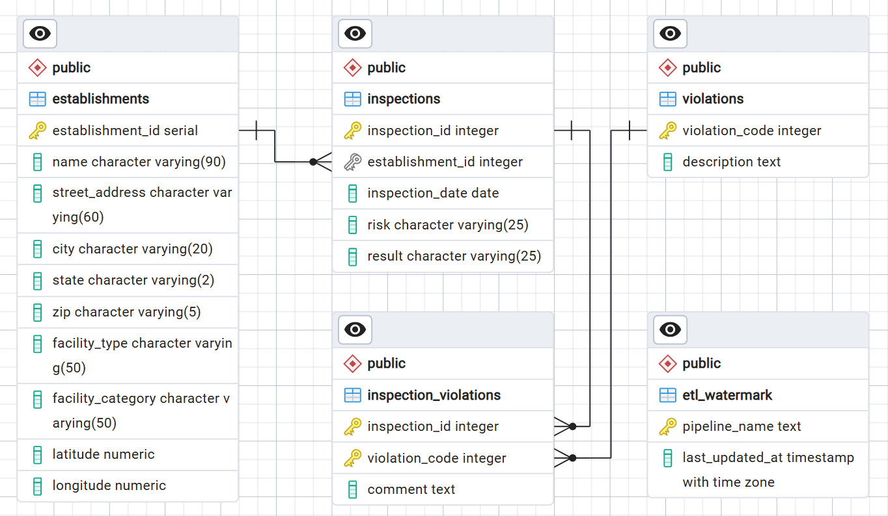
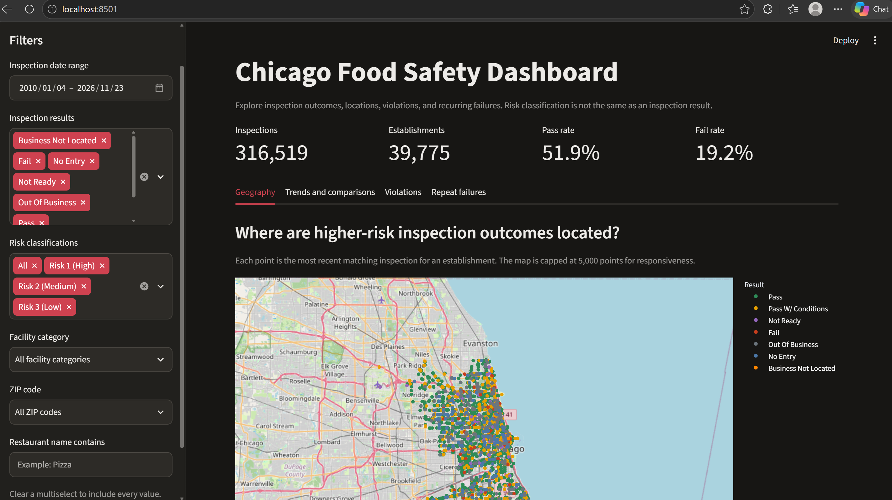

# Chicago Food Inspections

DAEN 328 Team 1 term project: an ETL pipeline, PostgreSQL database, and Streamlit dashboard for Chicago food-inspection data. This project uses the Chicago Food Inspections API available at the `https://data.cityofchicago.org/resource/4ijn-s7e5.json` endpoint. The API yields approximately 319,000 rows and 17 columns dating back to 1/1/2010, and it is updated daily with new inspections. The goal of this pipeline and dashboard is to answer the following questions:

1. Where are establishments with higher food-safety risks or failed results located?
2. Which geographic areas have the highest inspection failure rates?
3. Have pass, fail, and conditional-pass rates changed over time?
4. What are the most common violations?
5. How do inspection outcomes differ by risk classification?
6. Which establishments repeatedly fail inspections?
7. Which facility types have higher failure rates?

To accomplish this, the dashboard has numerous plots and can filter by date, result, risk classification, facility type, ZIP code, and restaurant name. However, the current data does not contain Chicago neighborhood or community-area boundaries, so the area comparison uses ZIP code as a proxy.

## Run the project

1. Start Docker Desktop.
2. Create the local environment file:

   ```powershell
   Copy-Item .env.sample .env
   ```

3. Open `.env` and replace both `REPLACE_ME` values with the same local development password. The `.env` file is ignored by Git and must not be committed.
4. Build and start the stack:

   ```powershell
   docker compose up --build
   ```

5. After the ETL service finishes, open <http://localhost:8501>.
6. Stop the services with `Ctrl+C`, then run `docker compose down`.

To remove the PostgreSQL volume and reload all data from scratch, use `docker compose down -v`. This permanently deletes the local project database.

## Database structure

The database contains five tables: `establishments`, `inspections`, `violations`, `inspection_violations` and `etl_watermark`. The `establishments` table contains information about the establishments undergoing inspections including their name, location, and facility type (e.g. Grocery Store, Gas Station, etc.). The `inspections` table contains the inspection ID assigned by the data source, inspection date, result, and more. The `violations` table includes all city codes that are violated at least once in the dataset, including both the numeric code and a brief description. The `inspection_violations` table serves as a junction table between inspections and violations, and it lists all the violations for a specific inspection along with relevant comments. The last table is `etl_watermark` which stores the most recent successful load of the database for use during incremental data extraction. The ER Diagram for the database is shown below.



## Incremental Extraction

To avoid extracting the same data repeatedly, the extraction process uses the watermark (`last_updated_at`) stored in the `etl_watermark` table to only pull records from the API whose `:updated_at` system field is on or after the watermark. In the case that there is no watermark, a full extraction of all records will occur. As part of each successful load, the watermark is added/updated with the current timestamp. UPSERT logic is also applied in database loading to prevent duplicate records from being inserted and to update outdated data.

## Dashboard Preview

Once the ETL has completed, the streamlit dashboard should automatically start and be available at <http://localhost:8501>. It should look like the image below:



## Group Contributions

1. Ayooluwatomi Daniel Olubajo: Team leader, streamlit dashboard (`streamlit_app.py`)
2. Colin Horwedel: API extraction (`extract.py`), incremental extraction (`extract.py`, `load.py`)
3. Kenneth Nguyen: Data transformation and related test cases (`transform.py`, `test_transform.py`), incremental extraction (`extract.py`, `load.py`)
4. Anna Williamson: Database schema and loading (`01_schema.sql`, `load.py`, `test_load.py`), Docker setup (`docker-compose.yml`, `Dockerfile`, `requirements.txt`)
